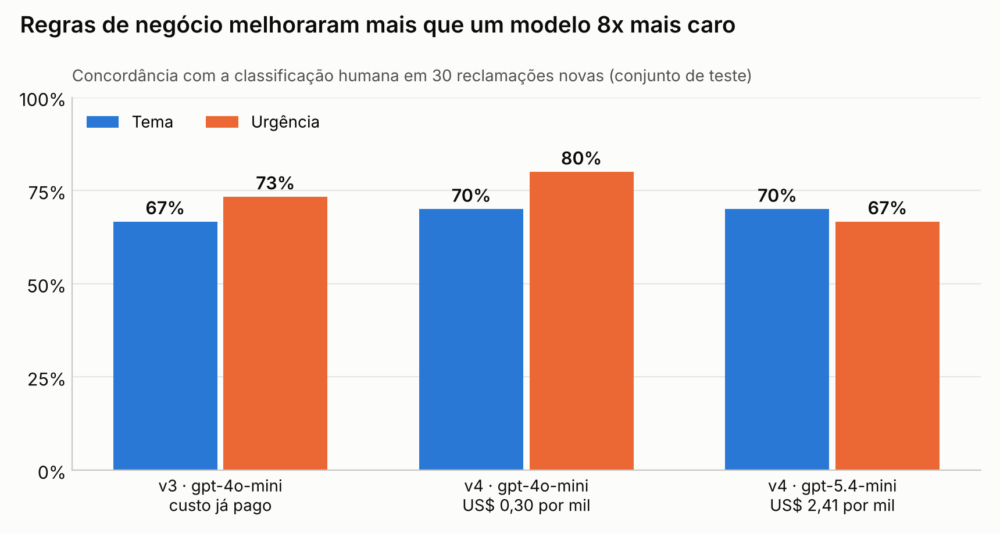
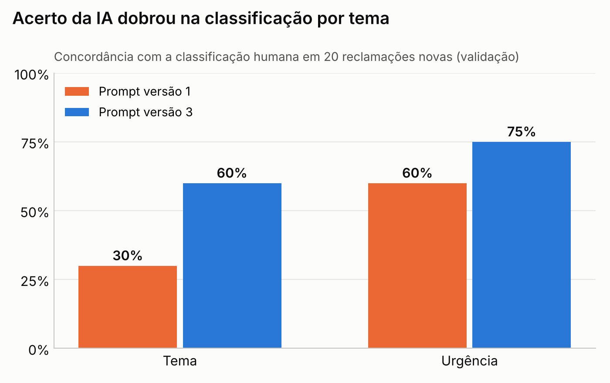

# Assistente de Reclamações com IA

Classificação automática de reclamações de clientes com IA generativa: **tema, urgência, risco de perder o cliente, ação sugerida e rascunho de resposta**, com a qualidade medida contra uma classificação humana.

## O problema

Empresas de e-commerce e delivery recebem milhares de reclamações por dia. O time de atendimento precisa saber **o que tratar primeiro**, **quais problemas mais geram insatisfação** e **como responder bem e rápido**. Ler tudo à mão não escala, e uma fila em ordem de chegada trata igual o cliente que só reclamou da cor e o que pagou e não recebeu.

## O que o projeto entrega

| Para quem | O que recebe |
| --- | --- |
| Gestão do atendimento | Temas que mais geram reclamação e matriz de prioridade (urgência × risco) |
| Atendente | Resumo do caso, justificativa da classificação, próximo passo sugerido e rascunho de resposta para revisar |
| Operação e logística | Onde o processo falha: não entrega, erro de separação, avaria, e quais clientes já procuraram a loja sem solução |

> A resposta sugerida é um **rascunho para um atendente revisar**, nunca um envio automático.

## Resultado em uma frase

**O maior ganho veio de transformar critérios de negócio em regras escritas, e não de trocar por um modelo mais caro:** com um guia de classificação, o `gpt-4o-mini` chegou a 80% de concordância com a pessoa na urgência, enquanto o `gpt-5.4-mini`, 8 vezes mais caro, ficou em 67%.



## Principais achados


- **68% das reclamações vêm de entrega e separação de pedidos:** produto não entregue (36%), errado ou incompleto (26%) e atraso (6%). O maior ganho está na operação, não no atendimento.
- **Em 36 reclamações (18%), o cliente já tinha procurado a loja sem solução:** a operação falhou duas vezes com o mesmo cliente.


- **47 de 200 reclamações combinam urgência alta e risco alto de perder o cliente.** É a fila de "atender hoje".
- **74 casos têm urgência alta, mas risco médio:** o cliente precisa de solução rápida, mas ainda não fala em abandonar a loja. Na versão 1, o risco apenas copiava a urgência; separar os dois deixou a fila prioritária menor e mais útil.

## Como a qualidade foi medida

Uma IA que classifica sem ser avaliada é só uma opinião. Por isso, cada versão do prompt foi comparada com uma classificação humana feita sem ver a resposta da IA, em três conjuntos separados de reclamações:

| Conjunto | Tamanho | Para que serve |
| --- | --- | --- |
| Gabarito | 30 | Encontrar os erros e ajustar os prompts das versões 2 e 3 |
| Validação | 20 | Medir a versão 3 em casos que o ajuste não viu |
| Teste | 30 | Medir a versão 4 e comparar os modelos em casos totalmente novos |

**Evolução do acerto** (concordância com a classificação humana):

| Versão do prompt | Gabarito (30) | Validação (20 novas) | Teste (30 novas) |
| --- | --- | --- | --- |
| 1 — instruções básicas | tema 60% · urgência 50% | tema 30% · urgência 60% | — |
| 2 — definição de cada tema | tema 70% · urgência 63% | — | — |
| 3 — critérios de negócio para urgência | tema 77% · urgência 73% | tema 60% · urgência 75% | tema 67% · urgência 73% |
| **4 — guia de classificação** (`gpt-4o-mini`) | — | — | **tema 70% · urgência 80%** |
| 4 — guia de classificação (`gpt-5.4-mini`) | — | — | tema 70% · urgência 67% |



**O que mudou de uma versão para outra:**
- **Versão 2:** cada tema ganhou uma definição. A IA confundia *atraso* (o produto chegou fora do prazo) com *não entregue* (o cliente ainda espera), o que muda a prioridade do caso.
- **Versão 3:** a urgência passou a seguir um critério de gestão: **o cliente que pagou e ficou sem o que comprou é prioridade alta**, mesmo que o problema seja "só" um item errado. O risco de perder o cliente ganhou critérios próprios.
- **Versão 4:** a análise humana dos erros virou um [guia de classificação](GUIA_DE_CLASSIFICACAO.md), usado igual pela pessoa e pelo prompt:
  - **Sinais de tempo no texto mudam a prioridade:** "estou aguardando o produto" é urgência baixa (pode estar no prazo); "**ainda** estou esperando" é média; "**já passou do prazo**" ou "**até hoje** não recebi" é alta.
  - **Com mais de um problema, o tema é o de maior prioridade.**
  - **Campo novo "cliente procurou a loja":** o tema fica sendo o problema de origem, e a falta de resposta da loja é registrada à parte.
  - Seis exemplos resolvidos no prompt e uma **justificativa curta antes da resposta**, que também ajuda o atendente a conferir.

## Custo e escolha do modelo

| Modelo (versão 4) | Tema | Urgência | Custo por mil reclamações |
| --- | --- | --- | --- |
| `gpt-4o-mini` | 70% | 80% | US$ 0,30 |
| `gpt-5.4-mini` | 70% | 67% | US$ 2,41 |

O modelo maior custa 8 vezes mais e não melhorou o resultado neste problema. A classificação final usa o `gpt-4o-mini`. Em uma operação com 1 milhão de reclamações, a diferença seria de cerca de US$ 300 contra US$ 2.400.

## Limitações

- **Amostra pequena:** com 30 casos no teste, cada erro vale cerca de 3 pontos. A diferença entre as versões 3 e 4 no mesmo teste é de 1 acerto no tema e 2 na urgência: a direção é boa, mas os percentuais são indicativos.
- **Parte dos erros é ambígua até para uma pessoa:** "demora muito pra chegar" pode ser atraso ou não entregue. A classificação humana também varia, e por isso critérios escritos ajudam a padronizar o atendimento.
- **Urgência alta ainda é a maioria (61%).** Quando quase tudo é urgente, a urgência sozinha não prioriza; por isso a fila combina urgência e risco.

## Próximas evoluções

- **Página em Streamlit:** o atendente cola uma reclamação e recebe a classificação e o rascunho de resposta.
- **Cruzamento com as outras tabelas da Olist em SQL** (pedidos, produtos, vendedores e prazos), para saber quais vendedores, categorias e regiões geram mais reclamações.
- **Escala:** API em lote (Batch) e saída estruturada com esquema.
- **Avaliação das respostas sugeridas**, com critérios como empatia e não prometer prazos.

## Como funciona

```
Avaliações Olist (99 mil) → filtro: nota 1 ou 2 com comentário (10 mil)
→ amostra aleatória de 200 → API da OpenAI (JSON estruturado)
→ planilha classificada → avaliação contra a classificação humana → gráficos
```

- **Modelos:** `gpt-4o-mini` com `temperature=0`; `gpt-5.4-mini` com `reasoning_effort="low"` (modelos com raciocínio não aceitam `temperature`).
- **Custo:** registrado por chamada a partir dos tokens usados.
- **Segurança:** a chave da API fica nos *Secrets* do Colab e nunca aparece no código.

## Arquivos

| Arquivo | Conteúdo |
| --- | --- |
| `01_classificacao_reclamacoes.ipynb` | Versões 1 a 3: dados, prompts, gabarito, validação e classificação |
| `02_versao4_comparacao_modelos.ipynb` | Versão 4: guia no prompt, teste e comparação de modelos e custos |
| `GUIA_DE_CLASSIFICACAO.md` | Regras de tema e urgência escritas a partir da análise humana dos erros |
| `reclamacoes_classificadas_v4.csv` | As 200 reclamações classificadas pela versão final (v4, `gpt-4o-mini`) |
| `reclamacoes_classificadas_final.csv` | As 200 reclamações classificadas pela versão 3 |
| `reclamacoes_classificadas.csv` | Resultado da versão 1 (ponto de partida) |
| `gabarito_preenchido.csv` | Classificação humana das 30 reclamações usadas no ajuste |
| `validacao_preenchido.csv` | Classificação humana das 20 reclamações de validação |
| `teste_preenchido.csv` | Classificação humana das 30 reclamações do teste final |
| `comparacao_modelos.csv` | Acerto, custo e tempo de cada combinação no teste |
| `graficos.py` | Gera os gráficos deste README |

## Como rodar

1. Abra os notebooks no Google Colab.
2. Crie o segredo `OPENAI_API_KEY` em *Secrets* (ícone 🔑) e ative o acesso ao notebook.
3. Para o notebook 01, baixe `olist_order_reviews_dataset.csv` da base [Brazilian E-Commerce Public Dataset by Olist](https://www.kaggle.com/datasets/olistbr/brazilian-ecommerce) e envie para o Colab. O notebook 02 usa o `reclamacoes_classificadas_final.csv` gerado pelo 01.
4. Rode as células na ordem.

## Tecnologias

Python · Pandas · OpenAI API · engenharia de prompt · avaliação de modelos · Matplotlib · Google Colab

## Dados

Base pública *Brazilian E-Commerce Public Dataset by Olist* (Kaggle), licença CC BY-NC-SA 4.0. Os nomes de lojas presentes nos textos já vêm substituídos por nomes fictícios na base original.

---

Projeto desenvolvido por **Diego dos Santos**, estudante de Tecnologia em Inteligência Artificial, a partir do Bootcamp Reclame Aqui – Dados e IA na Prática (DIO).
