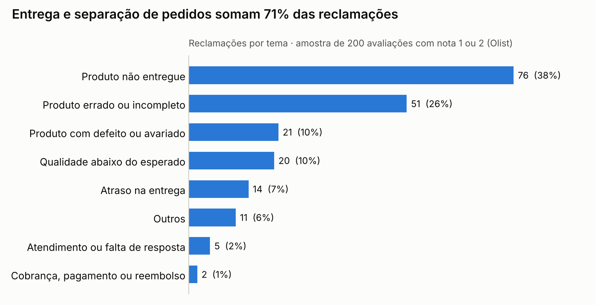
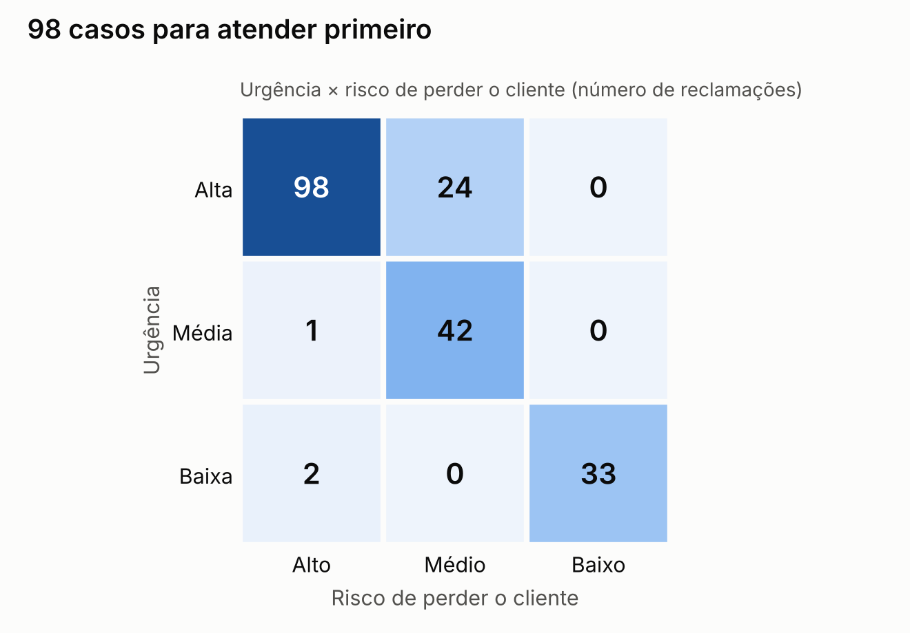

# Assistente de Reclamações com IA

Classificação automática de reclamações de clientes com IA generativa: **tema, urgência, risco de perder o cliente, ação sugerida e rascunho de resposta**, com a qualidade medida contra uma classificação humana.

## O problema

Empresas de e-commerce e delivery recebem milhares de reclamações por dia. O time de atendimento precisa saber **o que tratar primeiro**, **quais problemas mais geram insatisfação** e **como responder bem e rápido**. Ler tudo à mão não escala, e uma fila em ordem de chegada trata igual o cliente que só reclamou da cor e o que pagou e não recebeu.

## O que o projeto entrega

| Para quem | O que recebe |
| --- | --- |
| Gestão do atendimento | Temas que mais geram reclamação e matriz de prioridade (urgência × risco) |
| Atendente | Resumo do caso, próximo passo sugerido e rascunho de resposta para revisar |
| Operação e logística | Onde o processo falha: não entrega, erro de separação, avaria |

> A resposta sugerida é um **rascunho para um atendente revisar**, nunca um envio automático.

## Principais resultados



- **71% das reclamações vêm de entrega e separação de pedidos:** produto não entregue (38%), errado ou incompleto (26%) e atraso (7%). O maior ganho está na operação, não no atendimento.



- **98 de 200 reclamações combinam urgência alta e risco alto de perder o cliente.** É a fila de "atender hoje".
- **24 casos têm urgência alta, mas risco médio:** o cliente precisa de solução rápida, mas ainda não fala em abandonar a loja.

## Como a qualidade foi medida

Uma IA que classifica sem ser avaliada é só uma opinião. Por isso:

1. **Gabarito humano:** classifiquei manualmente 30 reclamações (tema e urgência), sem ver a resposta da IA.
2. **Três versões do prompt**, cada uma ajustada a partir dos erros da anterior.
3. **Validação justa:** como as versões 2 e 3 foram ajustadas olhando o gabarito, medi o resultado final em **20 reclamações novas**, que nenhuma versão do prompt tinha visto.

| Versão do prompt | Gabarito (30, usado no ajuste) | Validação (20 novas) |
| --- | --- | --- |
| 1 — instruções básicas | tema 60% · urgência 50% | tema 30% · urgência 60% |
| 2 — definição de cada tema | tema 70% · urgência 63% | — |
| 3 — critérios de negócio para urgência | tema 77% · urgência 73% | **tema 60% · urgência 75%** |


**O que mudou de uma versão para outra:**
- **Versão 2:** cada tema ganhou uma definição. A IA confundia *atraso* (o produto chegou fora do prazo) com *não entregue* (o cliente ainda espera), o que muda a prioridade do caso.
- **Versão 3:** a urgência passou a seguir um critério de gestão: **o cliente que pagou e ficou sem o que comprou é prioridade alta**, mesmo que o problema seja "só" um item errado. O risco de perder o cliente ganhou critérios próprios; na versão 1, ele apenas copiava a urgência.

## Limitações e próximos passos

- **5 dos 8 erros de tema na validação são o mesmo caso:** o cliente já procurou a loja e não teve resposta. A pessoa classifica como *atendimento*; a IA, pelo problema de origem. Os dois ângulos são válidos. A melhoria é um campo separado, **"cliente já procurou a loja: sim/não"**, que mostra onde a operação falhou duas vezes com o mesmo cliente.
- **61% dos casos ficaram com urgência alta.** Quando quase tudo é urgente, a urgência sozinha não prioriza. Por isso a fila combina urgência e risco.
- **A classificação humana também varia:** casos parecidos de "ainda estou esperando" receberam urgências diferentes no gabarito. Critérios escritos no prompt ajudam a padronizar o atendimento.
- **Amostra pequena:** 200 reclamações classificadas e 50 avaliadas à mão. Os percentuais são indicativos.

## Em andamento: versão 4

A análise dos erros da validação gerou um [guia de classificação](GUIA_DE_CLASSIFICACAO.md) com regras de negócio que o prompt ainda não tinha:

- **Sinais de tempo no texto mudam a prioridade:** "estou aguardando o produto" é urgência baixa (pode estar no prazo); "**ainda** estou esperando" é média; "**já passou do prazo**" ou "**até hoje** não recebi" é alta.
- **Com mais de um problema, o tema é o de maior prioridade.**
- **Campo novo "cliente procurou a loja":** o tema fica sendo o problema de origem, e a falta de resposta da loja é registrada à parte.

A versão 4 usa esse guia no prompt, com exemplos resolvidos e uma justificativa curta antes da resposta, e compara `gpt-4o-mini` com `gpt-5.4-mini` em acerto **e custo por mil reclamações**, medindo tudo em um conjunto de teste novo, com 30 reclamações.

## Próximas evoluções

- **Página em Streamlit:** o atendente cola uma reclamação e recebe a classificação e o rascunho de resposta.
- **Cruzamento com as outras tabelas da Olist em SQL** (pedidos, produtos, vendedores e prazos), para saber quais vendedores, categorias e regiões geram mais reclamações.
- **Escala:** API em lote (Batch) e saída estruturada com esquema, com o custo calculado para grandes volumes.

## Como funciona

```
Avaliações Olist (99 mil) → filtro: nota 1 ou 2 com comentário (10 mil)
→ amostra aleatória de 200 → API da OpenAI (gpt-4o-mini, JSON estruturado)
→ planilha classificada → avaliação contra o gabarito humano → gráficos
```

- **Modelo:** `gpt-4o-mini`, com `temperature=0` (respostas consistentes) e saída em JSON garantida.
- **Custo:** a classificação das 200 reclamações custou centavos de dólar.
- **Segurança:** a chave da API fica nos *Secrets* do Colab e nunca aparece no código.

## Arquivos

| Arquivo | Conteúdo |
| --- | --- |
| `01_classificacao_reclamacoes.ipynb` | Notebook completo: dados, prompts v1 a v3, avaliação e classificação final |
| `reclamacoes_classificadas.csv` | Resultado da versão 1 do prompt (ponto de partida) |
| `reclamacoes_classificadas_final.csv` | As 200 reclamações classificadas pela versão final (v3) |
| `gabarito_preenchido.csv` | Classificação humana das 30 reclamações usadas no ajuste |
| `validacao_preenchido.csv` | Classificação humana das 20 reclamações de validação |
| `GUIA_DE_CLASSIFICACAO.md` | Regras de tema e urgência escritas a partir da análise humana dos erros |
| `graficos.py` | Gera os gráficos deste README |

## Como rodar

1. Abra o notebook no Google Colab.
2. Crie o segredo `OPENAI_API_KEY` em *Secrets* (ícone 🔑) e ative o acesso ao notebook.
3. Baixe `olist_order_reviews_dataset.csv` da base [Brazilian E-Commerce Public Dataset by Olist](https://www.kaggle.com/datasets/olistbr/brazilian-ecommerce) e envie para o Colab.
4. Rode as células na ordem.

## Tecnologias

Python · Pandas · OpenAI API · engenharia de prompt · Matplotlib · Google Colab

## Dados

Base pública *Brazilian E-Commerce Public Dataset by Olist* (Kaggle), licença CC BY-NC-SA 4.0. Os nomes de lojas presentes nos textos já vêm substituídos por nomes fictícios na base original.

---

Projeto desenvolvido por **Diego dos Santos**, estudante de Tecnologia em Inteligência Artificial, a partir do Bootcamp Reclame Aqui – Dados e IA na Prática (DIO).
